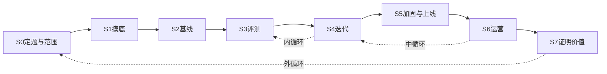

业务方发来一句话：「做个能问经营数据的助手」，或者「做一个能答产品问题的客服」。没有产品经理，没有需求文档，也没有评测集。刚工作一两年的人，第一反应多半是选模型、搭框架、写第一版提示词。两周后能演示了，对方说「挺好」。真实用户来了以后，问法和你测过的不一样，数字或答案偶尔对不上，你不知道该先修哪一个。

这篇写给我自己，也写给处在这个位置上的人。它要帮你做三件事：对上自己现在在哪一关，知道这一关怎样算过，下一周只做这一关还缺的那一步。

下面两处都是举例，用来说明同一套做法在不同任务里长什么样。一个是经营问数，一个是客服检索。它们不是同一套系统。文中的比例，除了附录里标明的算例，都只说明高低和结论。

先定义什么算解决，再写系统。先跑最简单的方案，再谈更复杂的结构。看失败样本，并且让评测先能用起来。上线是实验的开始。

> 怎么读：先勾下面的出关表，对上自己在哪一关。做到一半，用文末体检表打分，分最低的那一关就是下一步。成功标准、实验记录、周报和小样本怎么读数在附录，用到再翻。

这套顺序来自已经公开的工程经验。数据挖掘的生命周期、机器学习工程里「先把基础设施做对」的那些规则，以及这几年做大模型应用的实践，在几件事上是一致的：先把问题说清，从简单方案开始，用误差分析决定改哪里，围绕模型的系统比单次调用重要，自动裁判先经过人的校准。大模型改变了三处。数据从训练集变成评测集和上下文。迭代从特征和训练变成提示词、上下文、工具和流程。评估从单一数值变成代码断言、经人校准的裁判、线上信号这三层。出处放在文末。

## 先看这一页

一条主线是问题、评测、系统、上线、运营。顺序乱了会返工：没有问题定义，评测集不知道该收什么；没有评测，改系统只能凭感觉；没上线，评测集反映的是你想象中的用户。阶段会往回跳，编号只表示第一次走到这里的顺序。



三个循环的时间尺度不同。

- 内循环按小时到天转：看失败，归成一类，只改这一类，跑回归。大部分开发时间在这里。
- 中循环按周转：过了门槛再发布，对线上坏例做回放，收进回归集。
- 外循环按月转：用真实问法和用户实际在做的事，重新看问题定义，写下明确不做的事。

只有内循环的项目，系统会越改越细，方向一直不变。

| 阶段 | 要回答的问题 | 出关条件 |
| --- | --- | --- |
| S0 定题与范围 | 要不要做？做成什么样算成功？ | 一页成功标准写完，做过量级检查，有人负责裁定质量，有明确不做的清单 |
| S1 摸底 | 真实输入和知识长什么样？ | 亲手看过真实样本，有数据画像、种子样本和权限边界 |
| S2 基线 | 最简单的方案能做到多少？ | 端到端跑通，任意一轮能回放，种子集上有基线数字 |
| S3 评测 | 怎么知道变好还是变坏？ | 失败分类互斥，有人工标准，裁判对过，上线规则事先写好 |
| S4 迭代 | 下一步改哪里？何时值得更复杂？ | 一次只改一处，回归没坏，升复杂度有对照 |
| S5 加固与上线 | 能不能稳定地给真人用？ | 硬约束在代码里，失败有兜底，能回滚，灰度条件可判定 |
| S6 运营 | 上线后怎么持续变好？ | 固定节奏看样本、修复、回放、回归，周报口径稳定 |
| S7 证明价值与沉淀 | 它有没有用？别人能不能接手？ | 价值报告写清方法和证据等级，文档能让下一个人值班 |

出关条件缺了哪一条，下一周就补那一条。

## S0 定题与范围

**要回答的问题。** 这是谁的什么决定？现在没有它时人怎么做？错了代价多大？一定要用模型吗？做成什么样算成功？愿意投入多久？

**出关条件。**

- 一句话写得出用户、场景、要支持的决定，以及做不到时怎么兜底。
- 成功标准一页纸写完。业务、产品、算法三层和护栏都有数字，需求方确认过。模板在附录 A。
- 做过量级检查：业务指标测得出来，或者写明测不出来时用什么代理指标。
- 质量负责人有名字。最后由这个人判断「这条回答算不算对」。
- 明确不做的清单写进文档。
- 四类风险里标出最大的一类，以及用什么最便宜的办法验证。
- 时间预算写下来了，预算内做什么、不做什么也写下来了。

**做法。**

把一句话需求翻译成任务：输入是什么，输出是什么，谁在用，在什么场景用，什么算对，错了怎样。用户雇这个产品完成什么任务，什么情况下会不用。不用的条件，后面往往会变成上线红线。

三个人分开写。提需求的人、每天使用的人、拍板的人，经常不是同一个。没有产品经理时，附录 B 的问题要你自己问。出关前至少问清：谁在用、现在怎么做、什么算对、错了怎样、数据在哪、谁拍板。

先写非模型方案能做到什么：一张看板、一份固定报表、一套规则、一个搜索框。规则能拿到的那部分收益，先拿掉。非模型方案已经能完成大部分任务时，先做那个方案。

成功标准分三层，再加护栏。每一项都要有数字。模糊的感觉也要变成可数的东西。

| 层 | 回答什么 | 举例 |
| --- | --- | --- |
| 业务 | 组织得到了什么 | 工单量、人工处理时长 |
| 产品 | 用户得到了什么 | 解决率、敢不敢用这个数 |
| 算法 | 系统内部做得怎样 | 检索命中、槽位命中、裁判通过率 |
| 护栏 | 不能突破的线 | 延迟、单轮成本、越权为零、哪些话不能说 |

三层之间的关系要事后验证，不能默认成立。检索命中涨了，解决率可能不动。解决率涨了，工单可能不降：要么流量不够，要么用户本来就不会为这类问题提工单。

量级检查放在写目标的同时做。两组比例要比较时，80% 功效、显著性水平 0.05，每组大约需要

\[
n \approx \frac{2 \cdot p(1-p) \cdot 2.8^{2}}{\delta^{2}}
\]

个独立单元。\(p\) 是基准比例，\(\delta\) 是你想测出的差值。基准比例 20%、想测出 2 个百分点的变化，每组大约要 6300 个单元。一个月只有几百轮对话时，用工单占比当业务指标，事先就知道测不出来。这时换成更接近单次使用的代理指标，或者一开始就承认结论只能是观察性的。算法和一道完整算例在附录 F。

风险先排再做。价值：用户会不会用。可用：用户会不会操作，例如面对空白输入框不知道能问什么。可行：做不做得出，例如口径理解不了，或延迟太高。可持续：成本、权限、合规、供应商依赖撑不撑得住。先处理最大的那一类。可行性用一天的脚本跑真实问句；可用性找三个真实用户试一次。

复杂度从低到高走：不用模型，规则，单次模型调用，固定流程（提示链、路由、并行、分步校验），由模型自己决定下一步，再是多角色协作。每升一级，出错面和调试成本都上去，投入大约多一个数量级。三条都沾上时才考虑让模型自己决定下一步：决策本身复杂、规则已经维护不住、高度依赖非结构化文本。三条都不沾，先停在更下面一级。

时间先定死，范围后定。先写愿意投入多久，再决定这段时间里做到哪。路线图按实验排，按功能排会变成每个都做到七成、没有一个能给人用。同时写能力边界：能做什么，明确不做什么，做不到时怎么回应。这份边界以后就是对用户的承诺，也是评测里「该拒绝」那一类的来源。

**举例。** 经营问数里，每天使用的人是名下有多处场地的区域管理者：先扫异常，再下钻。关键任务可以写成一句：把「今天该盯什么」变成可核对的事实，和可以执行的下一步。让人不用的条件也写得出来：数字错了、悄悄换成另一个指标、编造没有查过的数、澄清停不下来。这些条件后来就是灰度时的红线。领导想看的固定报告，使用者很少会自己打开，这种需求单独记进不做清单，或者只做最低限度的维护。

**反例。** 需求一来就开始比较哪个框架好。三周以后才发现，对方要的是每天一张异常清单。另一种常见情况是只写「准确率 90%」，不写分母，也不写护栏。

## S1 摸底

**要回答的问题。** 真实的输入长什么样？知识和数据在哪、质量如何、谁负责？谁能看什么？

**出关条件。**

- 亲手看过一批真实样本，并留下一句话备注。新开项目至少看 100 条；暂时没有这么多，就把能拿到的真实输入看完，并写明还缺什么。
- 一页数据画像：分布，加上大约 10 条典型样本和 10 条难样本。
- 种子样本几十到一百条，带初步标签，以及「理想结果应该满足什么」。
- 数据和知识清单写清负责人和口径来源。
- 权限写清在哪一层判断，拿不到权限时怎么办。
- 跨团队有缺口时，有一份待确认清单。确认之前，相关能力保持关闭。

**做法。**

真实输入优先于写代码。历史工单、聊天记录、搜索日志、手册、表结构，能要到就先要。拿不到，就找三到五个真实用户，请他们写下最近真正想问的问题。边看边记一句话：这条好在哪，或者坏在哪。这是后面失败分类的原料。需求方挑出来的样例要看，但不能只看那些。

分布至少看四件事：意图的头部和长尾，语言和渠道，一句话里问几件事的比例，带附件、带编号、带图片的比例。知识源要看覆盖了多少意图、有没有互相冲突的版本、谁负责更新。手册版本冲突、区域口径不同，进了检索库就会互相抢。

历史日志反映的是旧系统能答什么，不完全是用户想问什么。旧系统只能查简单的数，日志里就几乎全是简单查数。这不能当成「用户不需要建议」的证据。

合成数据可以用来补问法，用来扩写输入。期望答案仍然由人定。合成集上的提升，最多说明那一类问题的上限，不能写成生产收益。

别人维护的文档是真源，只读。口径有缺口时列成清单交给对方。确认之前失败即关闭：直接说这个口径还不能查，不用相近字段顶上。同名字段不代表同一个指标。

权限在这一关就要问。谁能看什么，在服务端的哪一层判断，身份拿不到时是失败还是退回更大的范围。退回更大的范围，上线后就是越权。

**举例。** 客服检索里，亲手看过真实流量以后，发现一次问多件事的只占很小一部分。第一版就不做拆题。已经有可用的模型服务，就复用，不另起一套。

**反例。** 用自己编的干净问句做测试。或者口径不清时自己猜一个，上线后才被指出「这个数不是那个意思」。

## S2 基线

**要回答的问题。** 最简单的方案能做到多少？整条链路能不能跑通？任意一轮出了问题，能不能从日志里看完？

**出关条件。**

- 有一组地板数字：不做这一步、或不使用模型时的结果。
- 种子集上有基线数字，写明模型、提示词版本、评测集版本。
- 任意一轮都能从日志里完整回放。
- 改提示词不用改代码。提示词、检索参数、模型名都在版本管理里。

**做法。**

地板先做出来。没有地板，后面的提升没有参照。然后做最简单的可用方案，并接到真实入口上，哪怕只给内部的人用。

检索问答的地板到基线，通常是关键词或关键词加向量的混合检索，再加一次模型回答。名字、缩写、编号，关键词往往更稳，这条路留着。分类先用规则或小模型。问数先用能拿到的强模型、一个提示词、最少的工具，或者「选一个现成查询模板」。第一版就把重排、多路召回、微调、多角色协作叠上去，出了错不知道是哪一层。

大模型应用没有训练集也能做出能演示的版本。能演示和能给人用是两件事。所以这一关要留下的是基线分数和全链路轨迹，而不是再换一个更强的模型。轨迹里要有：用户输入、改写、检索候选和分数、提示词版本、模型名、工具调用、输出、各段耗时、错误。只记最终回复，出了问题分不清是检索、工具还是生成。一个能按条查看轨迹的页面，值得在第一天做。

基础设施和方案分开看。链路还没通时，不要同时改模型和改部署。第一次跑完，失败类型会自己冒出来，这比事先设计更准。

**举例。** 经营问数的最简方案，是选一个现成查询模板，对不上再让模型自己组织查询。它很快能演示。第一次认真看失败时，问题集中在两处：口径对不上，以及不该看到的范围被查到了。这两类不是靠事先讨论想全的。跑通当天没有在固定集合上记下分数，后面「改进了多少」就说不清。

**反例。** 第一版就上多角色、向量库、记忆和微调。或者先选一个会替你组装提示词的框架，出错时看不到实际发出去的内容。

## S3 评测

**要回答的问题。** 改了一处，整体是变好还是变坏？哪一类最该先修？谁来判？

**出关条件。**

- 失败分类互斥，每一类对应一种修复动作。
- 人工标准集的分母和来源写得清楚。标准不能来自被测系统自己的输出。
- 代码能判定的检查可以一键跑完。
- 用模型当裁判时，有一份和人工对齐的记录。流量大、失败少时看它抓得到失败、放得过正确样本的比例，不要只看整体准确率。
- 主指标和约束指标分开，约束指标有阈值。约束不达标，主指标再高也不能上。
- 准入规则在看结果之前写好。
- 有一组每次发布前必须通过的阻断用例。

**做法。**

先看轨迹，再冻结失败类型。抽大约 100 条，每条写一句为什么好或为什么不好。备注归并成类，数每类有多少。新样本不再冒出新类型，就可以停。检索问答先分开两件事：库里没有，还是库里有但没取出来。取出来了仍然答错，那是生成的问题。原因不互斥，统计会重复计数。类型对不上修复动作，统计完也不知道该干什么。检索问答可以用的一张表在附录 C。

评测分三层。能用代码判定的，不要交给裁判。

| 层 | 是什么 | 多久跑一次 | 例子 |
| --- | --- | --- | --- |
| 断言 | 代码可以判定 | 每次改动 | 格式、槽位、查询能否执行、越权是否为零 |
| 人工和裁判 | 需要判断的质量 | 每天或每次发布 | 有没有回应问题、建议是否只用了已经查到的数 |
| 线上信号 | 真实使用 | 持续 | 点踩、重复追问、做到一半离开 |

裁判只用于主观维度。一个失败模式一个裁判，用通过或不通过，加一句理由。1 到 5 分很难让两个人打出同一个意思。裁判上线前和人工对一次。只判断「有没有回应问题」、不去核对事实的裁判，会把数字错误放过去。期望答案也会标错。有争议的句子该澄清还是直接答、该走哪一条路径，找质量负责人裁定，写成规则，以后都按这张表判。

能力评测和回归评测分开。能力评测是还做不好的题，用来决定下一步。回归评测是已经做好的题，通过率应接近全部通过，用来防止改坏。能力题稳定以后，毕业进回归集。

主指标是要优化的那个数。约束指标是必须过线的那个数，例如延迟上限、越权次数为零。防止对着评测集过拟合：一部分样本人工逐条看，用来做误差分析；另一部分只看分数，用来判断改动有没有泛化。调提示词时专门盯过的样本要打标记，报告时连同剔除后的结果一起报。

比较两个方案时，用同一批样本配对看。差值小于裁判自己的噪声，不能写成结论。看了数再定「怎样算赢」，会不自觉挑对自己有利的规则。样本不够时，写还差多少样本，不写「没有差别」。一次比较很多组，要做多重比较校正。具体算法、区间和功效在附录 F。

大模型应用的输出常常没有一份完整标准答案，所以评测是主要的工程工作，不是建模结束以后的一个子步骤。评测集要版本化，也要吸收线上新失败。全部通过，通常说明题还不够难。

**举例。** 客服检索里，如果让裁判拿一份「标准答案」去对，而这份答案又贴近现有方案的写法，现有方案会天然占优。同一个系统跑两次，裁判的判决也会翻转。端到端差值要大过这个噪声才读得出来。这时主证据改为人工标注的检索命中：库里有没有、取出来没有、送进模型没有。裁判仍然可以用，但先和人工对过，并且只负责它被校准过的那一种失败。

**反例。** 总分从 85% 到 87%，说不出哪一类变好，也说不出有没有别的类变差。或者裁判分数一路上涨，人工抽查却觉得越来越差。

## S4 迭代

**要回答的问题。** 失败集中在哪几类？修哪一类收益最大？什么时候值得换成更复杂的方案？

**出关条件。** 每一个新改动都满足下面四条。

- 相关分片上有配对比较。提升要过事先写好的准入规则；没过就写方向、当前功效、还差多少样本。
- 阻断用例和真实样本集没有回退。回退的每一条都有解释。
- 成本和延迟仍在 S0 的预算里。
- 有一份实验记录：对照是什么、只改了什么、决定上还是不上。模板在附录 D。负结论同样归档，写明什么条件下值得再试。

**做法。**

误差分析按这个顺序做：逐条看失败轨迹，每条写一句自由笔记；看过一批以后归并类型；按「占比 × 严重程度」排序；只修排第一的那一类；修完跑回归，确认这类变好、别的类没变差。某一类只占 5%，把它全部修好，整体错误率最多降 5 个点。这是这类修复的天花板。

值不值得做，可以粗算：流量占比 × 当前失败率 × 可修复性 ÷ 成本。只占很小流量的问题，修到全部正确，整体也只值那么一点。每轮都要先跑的步骤，成本落在全部流量上，收益只落在它能帮到的那一部分上。

手段按成本从低到高用。低的确实不够，再往上。

| 手段 | 适合修什么 |
| --- | --- |
| 提示词和少量示例 | 指令没说清、边界例子没给 |
| 上下文 | 缺领域知识、上下文太长太杂 |
| 工具和接口 | 选错工具、填错参数 |
| 检索 | 知识量大，需要按需取 |
| 拆开流程 | 一步做太多，需要分步验证 |
| 换模型 | 能力确实不够 |
| 微调 | 格式或风格要求极稳，并且有足够数据 |

工具说明含糊、参数容易填错，是让模型自己选工具时很常见的错误来源。花在把工具写清楚上的时间，常常不少于改总提示词。

一次只改一个变量。改提示词就只改提示词，换模型就只换模型。两条路线争论不下，就做对照：同一个评测集、同一套下游，只换要比较的那一层。两个改动绑在同一次发布里，就说不清是谁起的作用。

同一个输入多跑几次，结果可能不同。用户通常只看一次。会改数据、会发通知的操作，要看连续几次是不是都成功，不能用「多试几次总能碰对」来当稳定性。

规则债要单独看。修坏例最快的办法，常常是再加一条规则：遇到某个词就走某条路。一条一条看都合理，攒起来以后，没见过的说法进不去，见过的说法把模型锁死。用编程助手修坏例时，它最顺手的改法也常常是再加一条特判。判断标准是：这条规则是把线索放进上下文，模型仍然可以不采纳；还是命中以后就跳过模型。前者可以留，后者要警惕。

升复杂度要有证据，顺序仍然是：改提示词，改检索，加宽候选或重排或路由，固定的多步流程，让模型自己决定下一步，最后才是微调。真要让模型自己决定下一步，先把它关进边界里：最大步数、token 预算、超时；每一步的工具调用写进轨迹；预算用完或出错时，退回上一层已经确定的方案，不把做到一半的结果给用户。

跑实验前先过探针。例如重排模型，完全相同的两段文字得分应接近 1，无关文本接近 0。探针分两类，事先写清：阻断类不过就停；记录类只记下数字，供事后解释。合成集只能当上限。新方案先离线回放，再上一个默认关闭的开关。离线回放能回答的问题，不必占线上流量。效果到了平台期，去找新的信息来源，而不是继续精调已经在用的那个信号。

**举例。** 经营问数里，开槽一度靠规则：某个词预先锁指标，地名用正则，追问用正则判断是不是省略句。没见过的说法覆盖不到，见过的说法又把模型钉死。后来在同一个评测集上、下游的权限和计算全部不动，只换开槽这一层做对照。模型方案明显高于规则方案，慢的那一截也更稳，才把默认切过去。旧路径删掉，并注明不要当作现行实现。这种对照本身只要一两天。第一次觉得规则太重时就该做，不用攒很久。

**反例。** 提示词还没写清就去微调。或者一天改五处，出了新问题不知道是哪一处引起的。

## S5 加固与上线

**要回答的问题。** 真人同时来用时，它稳不稳？出错时用户看到什么？出事了能不能退回去？什么指标决定扩大，什么指标决定停止？

**出关条件。**

- 权限、校验、日期和金额都在代码里，并且有测试。
- 每条失败路径都有兜底和测试：超时、限流、空结果、模型报错。
- 模型版本、提示词、工具定义、超时和阈值都锁在版本管理里。每个阈值写得清谁定的、依据哪批数据、是在看标准答案之前还是之后定的。
- 上线门禁逐项给出结论：可以上、先不上、或带风险上。带风险上的，写清风险是什么、影响谁、怎么兜。
- 回滚走过一遍。谁有权回滚、回滚什么，当天查得到。
- 灰度的扩大条件和停止条件写成可判定的规则。能力说明已经告诉用户。

**做法。**

硬约束放在模型外面。权限在服务端解析，拿不到就失败，不退回全部数据。查询由规格编译，不接受任意查询。日期和金额由代码计算。要给下游用的结果，用结构化约束，校验不过就重试或报错。模型负责理解语义，代码负责守住边界。

失败要有路径。可重试的错误换个时间再试，参数错误换输入再试。循环用工具名加参数的指纹停下来。降级链写清每一跳：主模型、备用模型、一句用户能看懂的固定说明。每一跳都有超时、并发上限和熔断。失败时告诉用户下一步可以去哪。

版本锁住。供应商静默换模型会改变行为。配置和代码一起发布。发布用的版本和实验用的版本从第一天就分开。

稳定性和正确性分开门禁。压测回答稳不稳，不回答对不对。至少看四项：请求成功率、首 token 延迟的高分位、端到端延迟的高分位、走到固定说明的比例。目标留余量。并发从低往高加，按语言和输入类型分开看。用高分位，不用平均数代替。只由名次决定的融合分不能当绝对阈值：两路都排第一的候选，分数是固定的，和它相不相关无关。要卡阈值，用有绝对含义的相似度或概率，并在冻结的集合上标定。

护栏和说明一起做。输出侧过滤不该出现的联系方式、内部说法和竞品信息；输入侧防注入；敏感信息不进日志，或者先脱敏。对用户说清能做什么、能做到多好、数据时效是什么；不确定时收窄服务或请用户澄清；标明内容由模型生成。

灰度用三道门：评测过线，没有结构化崩溃（超时、死循环、越权为零），红线清空。红线来自 S0 的「让人不用」的条件，一旦出现就停止扩大。常见的四类可以这样处置：数字错了，当天修计算或查询；悄悄换成另一个指标，当天修核对；越权，立刻停止扩大并修权限；澄清停不下来，在约定时间内修协议。其余失败转回归，不把「再刷到很高」当上线前提。从能演示到真正稳，后面那一段往往比前面长得多。

灰度配套写在同一份清单里：少量、愿意反馈的真实用户；用他们的真实权限，不用管理员身份验收；回滚可以是回退提示词、关掉某一段文案、或者限流；连续一段时间没有红线才扩大，任意一条红线触发就停止扩大；点踩并能选原因。先让系统给信息和建议，人来做决定。高风险操作要人确认。可靠性被证明以后再放开。

**举例。** 经营问数里，能看哪些范围在服务端解析，拿不到就失败。日期由代码算，模型不输出绝对日期。灰度用一线人员的真实身份，不用更高权限的账号冒充他们验收。红线写成当天修、还是立刻停，而不是「感觉差不多了」。分数过线、红线清空，就可以给一小批人用。回滚人和值班如果只有清单、没有当天的落实记录，事后就查不到。

**反例。** 在提示词里写「只能查询用户有权限的范围」。或者没有回滚方案就全量打开。压测通过了，就当成质量也通过了。

## S6 运营

**要回答的问题。** 怎么知道它在变差？谁按什么节奏看？修好了怎么证明？

**出关条件。** 这一关是持续的。

- 每次发布前，回归和阻断用例通过。
- 周报按时写，窗口、分母、指标和上一期一致。口径变了就写明。模板在附录 E。
- 裁判和人工的一致程度有最近一次的数字。模型和提示词变了就重新对。
- 坏例从发现到进回归集的路径是固定的。

**做法。**

三路信号分开统计，合成一个「可用率」会把不同的修法混在一起。

- 用户反馈：点踩、点赞、原因。这是体验。人可以给正确结果点踩，也可以对错误结果什么都不点。
- 系统失败：报错、超时、有开始没有结束。这一轮没走完。
- 回答对错：答非所问、数字错、悄悄换了指标。要人对照轨迹判断。

每天固定时间看固定数量的样本。领域专家看过的输出，用来校准裁判、理解真实问法、发现没人点踩的错误。隐式信号比点踩更常见：同一个问题又问了一遍、用户在纠正、问到一半离开、只回一个「好」或「1」。这些要单独标出来。

在线裁判可以预标和排序，不能覆盖人工标注。标准会随时间漂，一致程度要定期再查。

修复按这一条流水线走：用 S3 的互斥分类标原因，改一处，用和生产相同的路径回放，再跑回归。截图和「我试了一下好了」不算修好。一天只修一类。红线当天处理。其余记下原话、轨迹和期望。知识更新单独走：审核、试跑、冲突检查、入库、回放。和现有口径冲突的内容先冻结。

每个修好的坏例都变成回归用例。周报同时报「用户当时感受到的」和「修复后回放的」。一周只有几十条时，比例附上区间。相邻两周的变化常常还落在区间里面，不要把它写成趋势。统计算的取值要和产品写入的取值一致，最好有测试，否则周报里某一栏会一直是空的。

有些问题补知识解决不了。用户要的是在对话里把事办完，不是再读一遍步骤。这种问题记成产品形态，不记成再补一条文档。

**举例。** 经营问数上线以后，点踩、跑失败、答错分开记。没人点踩的错数，只有逐条看轨迹才发现。如果用下来发现大部分轮次仍是内部试用，这些数字说明的是内部测试，替代不了真实用户的问法。

**反例。** 修一处坏一处，没有回归所以没人发现。或者每周的窗口和分母都在变，趋势图没法看。

## S7 证明价值与沉淀

**要回答的问题。** 它到底有没有用？用多少？换一个人能不能接着做？什么时候回到问题定义？

**出关条件。**

- 价值报告写清度量方法、分母、窗口、证据等级。测不出来就写测不出来，并写出原因。
- 下一个人照文档能把服务启动起来，并能值一天班。
- 明确不做的清单还在，每条有原因。主要决定有记录：为什么走这条路，当时的证据是什么。
- 废弃路径已经删除，并注明不要当作现行实现。

**做法。**

回到 S0 的业务指标和量级检查，再选度量方法。流量够，做对照实验，或留一组不开放的用户。流量不够，就在下面几种里选，并写明证据等级。

- 更接近单次使用的代理指标，例如对话结束后若干天内，同一用户有没有再提同类问题。
- 上线前后的趋势有没有拐。
- 和没上线的渠道或地区比。
- 只看系统覆盖的那几类问题。

证据等级写成三档：随机实验、近似实验、观察。观察性结论写明还有哪些因素混在里面。特别好看的数字先当它是错的，再去核对口径和分母。离线指标变好，不保证业务指标变好。两层之间对不上，先查瓶颈在不在你以为的那一层，再继续优化算法指标。

文档分三层。认知层写架构、主流程、目录职责，给下一个人、也给编程助手读。操作层写发布、回滚、标注、补知识的命令。困难点每篇写现象、怎么探测、回放命令、明确不做。一个人做的项目，最大的风险是只有你知道这些。

外循环每月走一次。真实问法和当初的设想有什么不同，哪些功能没人用，用户想完成但系统做不到的是什么。据此改优先级，并更新不做清单。坏例进回归集，能力题毕业进回归集，新模型来了用同一套评测就能判断要不要换。这是飞轮。废弃方案写进历史，第一句就标明不要当作现行实现，避免以后的人、或编程助手，把它恢复回来。

**举例。** 客服检索里，业务指标的波动小于当时流量能检测的下限，系统实际承接的会话又很少。结论只能写「测不出」，并写明原因：不是指标没定义，是单元数不够。这件事在 S0 的量级检查里就应该被预告。

**反例。** 上线以后才回头找数字。或者拿口径不同的两个窗口直接比。关键步骤只留在聊天记录里。

## 从头到尾都在的四件事

阶段按时间切，下面四件每一关都在。

**口径。** 每个对外的数登记一行：定义、分母、窗口、数据源、版本、负责人。口径一改，版本加一，周报里写明。最常见的坑是分母悄悄变了：这一周去掉了寒暄，上一周没去，两个数就不能比。

| 指标名 | 定义 | 分母 | 窗口 | 数据源 | 版本 | 负责人 |
| --- | --- | --- | --- | --- | --- | --- |
| 使用时解决率 | 用户当时得到可用回答的轮次占比 | 窗口内真实用户轮次，不含内部测试 | 周 | 人工标注 | 改分母时加一 | 名字 |

**飞轮。** 真实使用留下全链路日志，日志进入标注和误差分析，分析决定补知识、改检索或改提示词，修复后用同一条路径回放，通过的样本进入评测集，评测集再拿去看下一批真实使用。大模型应用里，这套循环多半落在知识、上下文和评测集上，而不落在重新训练上。

**版本。** 提示词、模型、知识库批次、评测集、超时和阈值都要能 diff。评测集有一份冻结的，用来比较；有一份滚动的，用来发现新问题。知识库的每一批有来源，能按批撤回。离线结果和线上不一致时，先查是不是评测没走线上的那一层注入，或者回放用的提示词已经不是线上那一版。

**谁拍板。** 这些事不要自己定了再同步：指标口径、对用户的承诺、权限范围、上线、扩大、停止。每周同步一次，内容固定：这一周的关键数字，这一周修了哪一类，下一周只修哪一类，需要对方拍板的事。

| 谁 | 关心什么 | 你给他什么 |
| --- | --- | --- |
| 业务方 | 这件事有没有用 | 周报开头的结论，以及价值报告 |
| 领域专家 | 这条回答算不算对 | 裁定权，和固定的抽查 |
| 数据维护方 | 口径不要被改义 | 只读的真源，和缺口清单 |

## 两处取舍

这两处，公开的经验给出了相反的建议。取舍取决于项目条件。

**成功标准何时写死。** 一种说法是动手前就把评测定好。另一种说法是通常不要评测驱动：人要先看到输出，才知道该用什么标准评，评估器应该为已经发现的错误来写。我的取舍是分开两层。产品级的成功标准、护栏、上线时不能破的线，在 S0 先写，这些不需要看输出。失败模式一级的评估器，在 S3 看过轨迹以后再写。能事先写死的硬约束例外，例如「不展示具体联系方式」，第一天就写成断言。

**人工评测占多少。** 一种说法是人工能少则少，宁可样本大一点、单条信号弱一点。另一种说法是领域专家在中心，裁判按专家的批注来建。我的取舍是：人负责发现问题、定义失败类型、校准裁判；自动化负责回归的量。流量小、每周能把真实使用标完时，人工标注就是主证据，裁判只做预标和排序。流量大了再反过来。

## 如果重来

按影响从大到小。这些是顺序问题。框架写了要做，做晚了就会返工。

1. 问题定义在动手的第一周写完。用户的任务、让人不用的条件、能力边界、不做清单，半天够了。写晚了，会做很多后来只能冻结的功能。
2. 基线跑通的当天就留下评测集，哪怕只有几十条。留晚了，评测集会带着实现的影子。期望答案有争议时，先裁定再优化，避免对着一份有争议的标准改系统。
3. 第一次觉得规则太重，就做只换一层的对照。对照本身只要一两天，拖久了，规则会互相盖住。
4. 灰度前先听真实用户怎么做这件事。问过去的真实行为，不问「你会不会用某个功能」。
5. 尽早让真实用户用起来。内部试用再多，也替代不了他们的问法。
6. 发布用的版本和实验用的版本从第一天分开。配置和代码一起发布。
7. 裁判至少和人对齐一次。只判断「有没有回应」的裁判，会让「数字对不对」一直停在待人工看。
8. 周报读取的取值和产品写入的取值要有测试。两边不一致时，某一栏会一直是空的，还不容易发现。

## 体检表

打分方式借用机器学习上线就绪度的那张表：0 分是没做，0.5 分是手工做过且有记录，1 分是自动化或形成了固定制度。每一关的分数是该关各项的平均。项目总分取八关里的最低分。用最低分，是因为任何一关漏掉，都会把整个项目拖住。

| 阶段 | 检查项 |
| --- | --- |
| S0 定题与范围 | 成功标准有三层加护栏，都有数字 / 做过量级检查 / 有质量负责人 / 有明确不做清单 |
| S1 摸底 | 亲手看过真实样本 / 有分布统计 / 知识源做过冲突检查 / 权限和失败即关闭写清了 |
| S2 基线 | 有地板和基线两组数字 / 任意一轮可完整回放 / 提示词和配置进版本管理 |
| S3 评测 | 失败分类互斥且对应修复动作 / 人工标准的分母清楚 / 裁判对过人或测过噪声 / 准入规则事先写好 |
| S4 迭代 | 新改动有配对比较和事先写好的规则 / 先离线回放，再走默认关闭的开关 / 负结论存档 |
| S5 加固与上线 | 门禁有结论 / 降级每一跳有测试 / 有告警 / 能回滚 / 每个阈值有来历 |
| S6 运营 | 固定节奏看样本 / 修复后用生产路径回放并回归 / 周报口径稳定 |
| S7 证明价值与沉淀 | 价值报告写清方法和证据等级 / 文档三层齐全 / 下一个人能照文档值班 |

0 分更像还在试。0.5 分是能用，但靠人盯着。到 1 分，才谈得上换人接手。下一步补最低的那一关，不平行开三关。

## 附录

### A. 成功标准一页纸

```markdown
# <项目名> 成功标准 v1（日期）

## 一句话
给 <谁> 在 <什么场景> 解决 <什么问题>，做不到时 <怎么兜底>。

## 业务层
- 指标：            基线：        目标：        测量方法：
- 量级检查：每组需要约 ___ 个单元，我们每月约 ___ 个 → 能测 / 不能测，代理指标是 ___

## 产品层
- 解决率（分母：___）：目标 ___
- 用户反馈：___

## 算法层
- 检索命中 / 槽位命中 / 裁判通过率 / ___：目标 ___，评测集：___

## 护栏
- 首 token 高分位 ≤ ___ 秒，端到端高分位 ≤ ___ 秒，成功率 ≥ ___%
- 单轮成本 ≤ ___
- 绝对不能说或不能做：___

## 质量负责人
___

## 明确不做（第一版）
- ___
```

### B. 向需求方提的问题

1. 谁在用？在什么页面、什么时间点用？
2. 他们现在遇到这个问题时怎么解决？要多久？
3. 什么样的回答算对？能给 10 个好例子和 10 个坏例子吗？
4. 答错了最坏会怎样？哪些话绝对不能说？
5. 做不到的时候希望用户去哪？
6. 知识和数据在哪？谁负责更新？多久更新一次？
7. 有没有历史日志或工单可以看？有没有权限限制？
8. 一个月大概有多少次使用？
9. 上线后用什么数字判断它有没有用？现在这个数字是多少？
10. 有没有已经确定不做的范围、已经承诺的时间点？谁拍板？

### C. 失败分类表（检索问答）

原因互斥，每类对应一种修复。正交标签可以另标，例如「改写有误」「正文有错」「需要多跳」，不拿来代替这张表。

| 原因 | 判定 | 修复动作 |
| --- | --- | --- |
| 缺失知识 | 库里没有能回答的条目 | 补库，走审核入库 |
| 未进入候选 | 库里有，但检索结果里没有 | 改改写、加别名、调检索 |
| 进了候选但没用上 | 在候选里，没进送给模型的那几条 | 调排序或截断 |
| 回答错误 | 正确条目送给了模型，但答错了 | 改提示词或改正文 |
| 不该由系统答 | 需要人工办理，或超出承诺 | 改路由或改对用户的话术 |
| 跳过 | 寒暄、测试、无效输入 | 不计入分母 |
| 已解决 | 回答正确 | 收为回归用例 |

### D. 实验记录

```markdown
# 实验：<名字>（日期）
- 问题：要回答什么？
- 对照：现网 / 地板 / 只差一个因素的相邻方案
- 只改了什么：
- 评测集：名称、版本、分母、标准答案的来源
- 准入规则（跑之前写）：
- 探针（跑之前过）：
- 结果：指标和区间、变好 / 变差条数、配对检验的 p；同一族比较要写校正后的 p
- 不显著时：当前功效、按现有比例还要多少样本
- 证据等级：已确认 / 方向一致但未显著 / 无证据
- 决定：上 / 不上 / 补数据再看
- 什么条件下值得重做：
```

### E. 周报

```markdown
# <项目> 周报（窗口：起止时间，写明时区）

## 太长不看
| 指标 | 数字 |
| --- | --- |
| 使用时解决率 | x%（a / b，区间 [l, u]） |
| 修复后回放解决率 | y%（c / b，区间 [l, u]） |
| 使用人次 / 轮次 | |

## 口径说明（和上周相比有没有变）

## 当时没答好的原因（只算未解决的轮次，用互斥分类）

## 怎么修好的（每类几轮）

## 下一步（分开写「补数据」和「改产品」）
```

### F. 小样本上怎么读一个差值

这一节在你要宣布「变好了」或「没用」时再翻。主文里只需要记住三句：差值要在同一批样本上配对看；怎样算赢要在看数之前写好；样本不够就写还差多少，不写没有差别。

**单个比例附区间。** 一周只有几十条时，点估计会晃。29/48 = 60.4%，Wilson 95% 区间大约是 [46%, 73%]。相邻一周变成更高或更低，只要还落在这种宽度里，就不要写成趋势。分母变了，两个窗口更不能直接比。

**配对比较只看两边结论不同的样本。** 同一批题上比较两个方案，用精确的 McNemar 一类检验。两边都对或都错的题不提供信息。不一致的样本全部偏向一边，也要至少 6 条，才可能低于 0.05。胜负在 8 比 2 上下时，大约要 12 条不一致样本；10 好 2 坏大约 0.039，8 好 2 坏大约 0.11。不一致的样本只有个位数，就不要期待显著。

**不显著时算功效。** 功效按已经观察到的不一致比例和胜负比例来算，结果写成下一轮要补多少标注。不显著只说明当前样本还分不出，不说明两个方案一样。

**一次比很多组要校正。** 用 Holm 逐步校正。在一族比较里只挑最小的那个 p 来报，校正后它可能站不住。重排、改写、换模型如果是同一轮实验，就属于同一族。

**先量噪声。** 同一个系统跑两次，看裁判翻转了多少。差值小于这个翻转，不能写成结论。调参时盯过的样本要剔除后再报一遍。

**量级检查的算例。** 两组比例、80% 功效、\(\alpha = 0.05\) 时，每组大约

\[
n \approx \frac{2 \cdot p(1-p) \cdot 2.8^{2}}{\delta^{2}}
\]

基准比例 \(p = 0.2\)，想测出的差值 \(\delta = 0.02\)，每组大约 6300 个单元。每月只有几百轮时，这个业务指标测不出来。受控实验通常要到数千个实验单元，才谈得上检测几个百分点的变化。

## 参考文献

链接是公开出处。活文档的内容会变。

经典机器学习工程

- P. Chapman 等. *CRISP-DM 1.0*. 2000. 阶段可以往回走。 <https://public.dhe.ibm.com/software/analytics/spss/support/Modeler/Documentation/14/UserManual/CRISP-DM.pdf>
- S. Amershi 等. *Software Engineering for Machine Learning: A Case Study*. ICSE-SEIP 2019. <https://www.microsoft.com/en-us/research/publication/software-engineering-for-machine-learning-a-case-study/>
- M. Zinkevich. *Rules of Machine Learning*. Google. <https://developers.google.com/machine-learning/guides/rules-of-ml>
- D. Sculley 等. *Hidden Technical Debt in Machine Learning Systems*. NeurIPS 2015. <https://papers.nips.cc/paper_files/paper/2015/hash/86df7dcfd896fcaf2674f757a2463eba-Abstract.html>
- E. Breck 等. *The ML Test Score*. IEEE BigData 2017. 体检表的打分方式来自这里。 <https://research.google/pubs/the-ml-test-score-a-rubric-for-ml-production-readiness-and-technical-debt-reduction/>
- Google Cloud. *MLOps: Continuous delivery and automation pipelines in machine learning*. 文档主要面向预测式系统。 <https://cloud.google.com/architecture/mlops-continuous-delivery-and-automation-pipelines-in-machine-learning>
- A. Ng. *Machine Learning Yearning*. 开发集、单一指标、误差分析的天花板。 <https://info.deeplearning.ai/hubfs/andrew-ng-machine-learning-yearning-1.pdf>
- S. Shankar 等. *Operationalizing Machine Learning*. arXiv:2209.09125. <https://arxiv.org/abs/2209.09125>
- C. Huyen. *Machine Learning Systems Design*. <https://huyenchip.com/machine-learning-systems-design/design-a-machine-learning-system.html>

大模型应用

- Anthropic. *Building effective agents*. 2024. <https://www.anthropic.com/engineering/building-effective-agents>
- Anthropic. *Demystifying evals for AI agents*. 能力评测和回归评测，以及一次成功和次次成功的差别。 <https://www.anthropic.com/engineering/demystifying-evals-for-ai-agents>
- Anthropic. *Define success criteria and build evaluations*. <https://docs.claude.com/en/docs/test-and-evaluate/define-success>
- OpenAI. *A practical guide to building agents*. <https://cdn.openai.com/business-guides-and-resources/a-practical-guide-to-building-agents.pdf>
- OpenAI. *Evaluation best practices*. <https://platform.openai.com/docs/guides/evaluation-best-practices>
- H. Husain. *Your AI Product Needs Evals*. <https://hamel.dev/blog/posts/evals/>
- H. Husain. *Using LLM-as-a-Judge*. <https://hamel.dev/blog/posts/llm-judge/>
- H. Husain. *A Field Guide to Rapidly Improving AI Products*. <https://hamel.dev/blog/posts/field-guide/>
- H. Husain, S. Shankar. *AI Evals FAQ*. <https://hamel.dev/blog/posts/evals-faq/>
- E. Yan 等. *What We Learned from a Year of Building with LLMs*. <https://applied-llms.org/>
- E. Yan. *Patterns for Building LLM-based Systems & Products*. <https://eugeneyan.com/writing/llm-patterns/>
- S. Shankar 等. *Who Validates the Validators?* UIST 2024. <https://arxiv.org/abs/2404.12272>
- J. Liu. *How to Systematically Improve RAG Applications*. <https://jxnl.co/writing/2025/01/24/systematically-improving-rag-applications/>
- C. Huyen. *AI Engineering*. O'Reilly. <https://www.oreilly.com/library/view/ai-engineering/9781098166298/>
- C. Huyen. *Common pitfalls when building generative AI applications*. <https://huyenchip.com/2025/01/16/ai-engineering-pitfalls.html>

产品、可靠性和实验

- M. Cagan. *The Four Big Risks*. <https://www.svpg.com/four-big-risks/>
- R. Singer. *Shape Up*, 第 3 章 Set Boundaries. <https://basecamp.com/shapeup/1.2-chapter-03>
- S. Amershi 等. *Guidelines for Human-AI Interaction*. CHI 2019. <https://www.microsoft.com/en-us/research/publication/guidelines-for-human-ai-interaction/>
- B. Beyer 等. *Site Reliability Engineering*, 第 4 章. <https://sre.google/sre-book/service-level-objectives/>
- R. Kohavi, D. Tang, Y. Xu. *Trustworthy Online Controlled Experiments*. 总体评价指标、实验单元数量、特别好看的数字先怀疑。 <https://experimentguide.com/>
